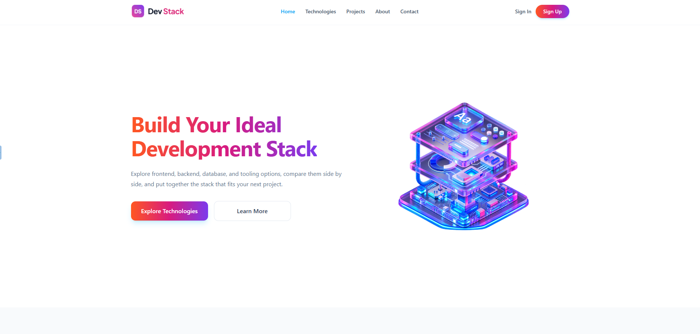
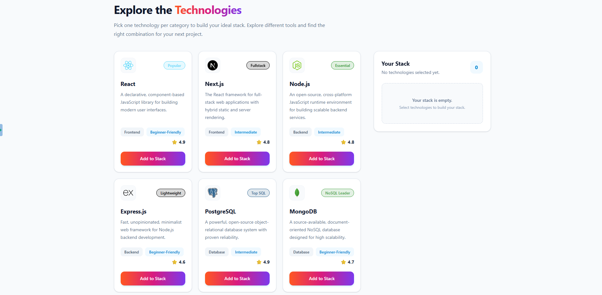

# DevStack

## Live Preview

[🚀 Visit Live Website](https://devstack-eosin.vercel.app/)

## Description

DevStack is a modern React-based web application that helps developers explore different technologies and build their development stack. Developers can browse technologies, add and remove them from their stack easily.

## Technologies Used

1. React
2. TypeScript
3. Tailwind CSS
4. React Toastify

## Features

### 1. Explore Different Technologies

Developers can browse different development technologies with information such as category, rating, difficulty, and description.

### 2. Build Your Stack

Developers can add learned technologies to their personal stack, remove individual technologies, or clear their entire stack easily.

### 3. Get Notifications

Get instant feedback through toast notifications when adding technologies or attempting to add a technology that is already in the stack.